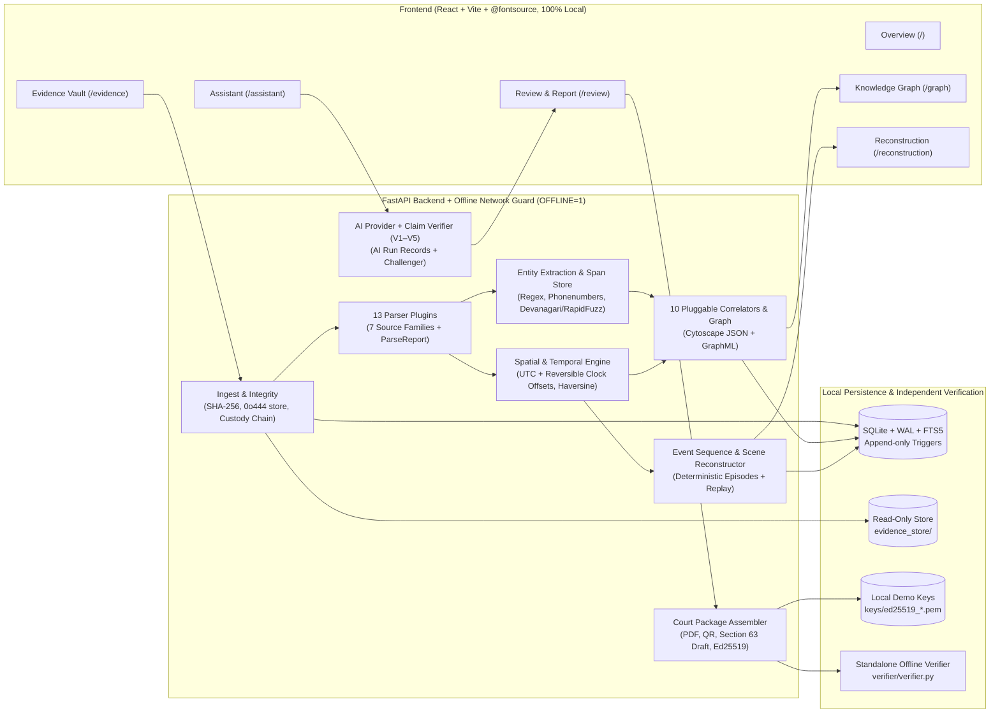

# PRAMAAN System Architecture (`docs/ARCHITECTURE.md`)

PRAMAAN is an offline, deterministic-first digital forensics correlation and crime reconstruction platform built around a strict separation between **court-admissible evidence** (Workspace 1, slate teal) and **investigative leads** (Workspace 2, amber).

---

## 1. End-to-End Architecture

---

## 2. Core Architectural Principles

1. **Zero-Network / Air-Gap Enforcement (`backend/app/network_guard.py`)**:
   - When `OFFLINE=1`, `install_network_guard()` wraps `socket.socket.connect`, `connect_ex`, and `create_connection` to block and count all non-loopback connections (`OfflineNetworkError`).
   - All frontend fonts (`@fontsource/source-serif-4`, `@fontsource/ibm-plex-sans`, `@fontsource/ibm-plex-mono`) and libraries (`cytoscape`, `vis-timeline`, `lucide-react`) are bundled locally in `frontend/dist/`.
2. **Evidence Integrity Foundation (`backend/app/ingest/`, `backend/app/integrity/`)**:
   - Uploads stream in 1 MB chunks, compute SHA-256 before persistence, write read-only (`0o444`) under `evidence_store/<sha256>`, and append `RECEIVED`, `HASHED`, and `TIMEZONE_ASSUMED` entries to the hash-chained `custody_log` table protected by SQLite `BEFORE UPDATE` and `BEFORE DELETE` triggers (`trg_custody_no_update`, `trg_custody_no_delete`).
   - Manifests are sealed with a deterministic binary Merkle tree (`merkle.py`) and signed with Ed25519 (`signer.py`, generating local demo keys on first run).
3. **Heterogeneous Source Normalization (`backend/app/parsers/`)**:
   - `ParserRegistry` dispatches 13 plugins across all 7 PS3 source families: Mobile (`CallLogParser`), Social Media (`WhatsAppParser`, `TelegramJSONParser`, `GenericSocialJSONParser`), CCTV & Media (`CCTVCameraIndexParser`, `CCTVVideoParser`, `ImageParser`), Cloud (`CloudLocationHistoryParser`, `CloudActivityCSVParser`), Financial (`BankPDFParser`, `BankCSVParser`), Email (`EmailParser` for `.eml`/`.mbox`), and Network (`NetworkLogParser`).
   - Every parser implements `parse_with_report()` enforcing `total_units == parsed_events + len(skipped_units) + len(errors)`.
4. **Spatio-Temporal & Authenticity Engines (`backend/app/spatial/`, `timeline/`, `authenticity/`)**:
   - All timestamps record `ts_original`, `tz_assumed`, `clock_offset_seconds`, `offset_source`, and corrected `ts_utc`; non-zero offsets log `CLOCK_OFFSET_RECORDED` in `custody_log`.
   - `spatial/analyzer.py` builds `observations` from cell towers (`tower_registry.csv`), cloud GPS, CCTV cameras, and the bundled `indian_cities_gazetteer.csv`, computing haversine distances for `CO_LOCATED`, `TRAVELLED`, and `IMPOSSIBLE_TRAVEL`.
   - `authenticity/` inspects EXIF tags + Error Level Analysis (`ela.py`) and row-by-row bank running balances (`statement_checks.py`).
5. **Correlation, Knowledge Graph, Event Sequence & Scene (`backend/app/correlate/`, `sequence/`, `scene/`)**:
   - 10 `BaseCorrelator` plugins emit deterministic `LEAD` edges with documented strength formulas (`docs/CORRELATION.md`).
   - `graph.py` exports Cytoscape JSON and GraphML XML (`docs/GRAPH_SCHEMA.md`).
   - `sequence/generator.py` segments events deterministically into `EP-001..` episodes; `scene/reconstructor.py` builds time-window / episode presence and step-by-step replay, explicitly marking unlocated actors `"not established"`.
6. **AI Governance & Human Admissibility Gate (`backend/app/ai/`, `verify/`, `assistant/`, `report/`)**:
   - `OllamaProvider` falls back to `DeterministicProvider` when offline/unavailable. Every AI call is persisted to `ai_runs` with its SHA-256 logged in `custody_log` (`AI_RUN_RECORDED`, `AI_VERIFIER_RECORDED`) and exposed via the 4-part `ExplainPanel`.
   - `claim_verifier.py` enforces deterministic Rules V1–V5 (`V1`: DB ref existence, `V2`: exact substring quote match, `V4`: zero-ref removal, `V5`: certainty-word neutralization).
   - Only items explicitly marked `APPROVED` by a human reviewer in `/review` enter the court report PDF and signed ZIP package (`render.py`, `package.py`).
